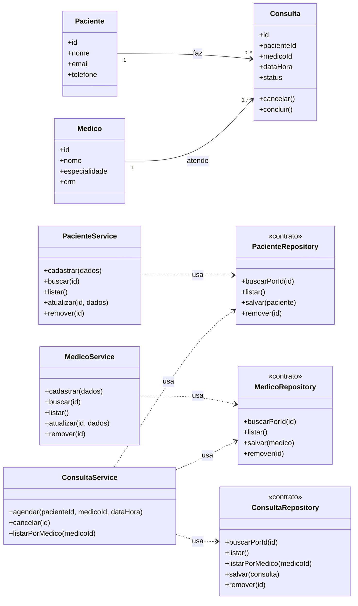

# Modelagem — Projeto 1

**Aluno:** Matheus Medeiros
**Domínio:** Agendamento de consultas de uma clínica médica

## 1. O domínio

A clínica cadastra pacientes e médicos e agenda consultas entre eles. Cada consulta
registra quem é o paciente, quem é o médico, a data e hora e o status. Um médico não
pode ter duas consultas no mesmo horário.

## 2. Entidades

| Entidade | Atributos | Relacionamentos |
|---|---|---|
| Paciente | id, nome, email, telefone | faz várias consultas |
| Medico | id, nome, especialidade, crm | atende várias consultas |
| Consulta | id, pacienteId, medicoId, dataHora, status | pertence a um paciente e a um médico |

## 3. Diagrama de classes

## 4. Responsabilidades

| Entidade | Regra (service) | Dados (repository) |
|---|---|---|
| Paciente | PacienteService | PacienteRepository |
| Medico | MedicoService | MedicoRepository |
| Consulta | ConsultaService | ConsultaRepository |

Cada entidade guarda apenas as regras do próprio objeto (por exemplo, uma consulta sabe
se cancelar). O processo de negócio fica no service, e o acesso aos dados fica no repository.

## 5. Onde apliquei SRP e DIP

- **SRP:** nenhuma entidade salva a si mesma nem envia e-mail. Guardar os dados é papel
  dos repositories, e o processo de agendar, cancelar e listar é papel dos services. Cada
  classe tem um único motivo para mudar.
- **DIP:** cada service depende do contrato do repository, recebido pelo construtor, e
  nunca de um banco de dados. O ConsultaService não sabe se os dados estão em memória
  ou em SQLite, então o armazenamento pode trocar sem mexer na regra.

## 6. Fora do escopo (YAGNI)

Login, pagamento, prontuário e relatórios não entram no Projeto 1.